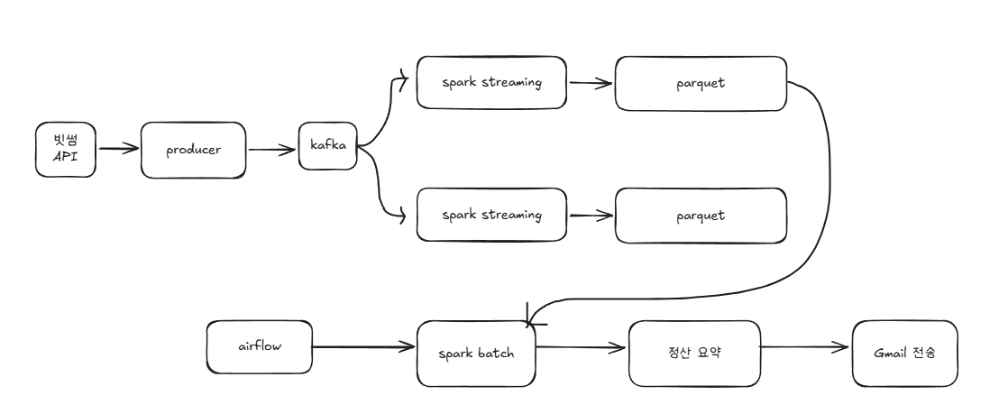

# bithumb-streaming-pipeline

> 금융 데이터를 다뤄보고 싶었지만, 금융권 데이터는 대부분 개인정보로 보호되어 개인이 접근하기 어렵습니다. 공개된 주식 체결 데이터도 확인해 보았지만, 국내, 해외 주식 모두 장 운영 시간에만 데이터가 발생합니다. 저는 멈추지 않고 들어오는 데이터를 끊김 없이 처리하는 경험을 해보고 싶었고, 그래서 24시간 체결이 발생하는 빗썸의 BTC 체결 데이터를 수집하는 이 프로젝트를 시작했습니다.

빗썸 BTC 체결 데이터를 WebSocket으로 수집해 Kafka에 적재하고, Spark Structured Streaming으로 원천 데이터와 1분봉 데이터를 Parquet 파일로 저장합니다. 매일 01:00에는 Airflow가 전날 원천 데이터를 다시 집계해 품질을 점검하고, 결과를 이메일로 보고합니다. 

현재 시스템은 Oracle Cloud 무료 서버에서 상시 운영 중입니다. (수집 시작일: 2026-10-29)

 

## 구조

1. **수집**: producer가 빗썸 WebSocket에서 체결 데이터를 받아 Kafka `bithumb-trades` 토픽에 적재합니다.
2. **스트리밍 저장**: Spark 스트리밍 잡 2개가 같은 토픽을 각각 읽습니다.
   - 원천 체결 데이터를 날짜·시간별 Parquet으로 저장
   - 1분봉(OHLCV)을 집계해 날짜별 Parquet으로 저장
3. **일일 정산**: 매일 01:00 Airflow가 전날 원천 데이터를 Spark 배치로 다시 집계해 요약 리포트를 만들고, Gmail SMTP로 발송합니다.
 

## 기술 스택

 

## 동작 방식

### 1. 수집 — `ingestion/bithumb_producer.py`

### 2. 원천 저장 — `processing/save_raw_trades.py`

### 3. 1분봉 집계 — `processing/bithumb_stream_aggregate.py`

### 4. 일일 정산과 리포트 — `airflow/dags/`, `processing/batch_daily_reconcile_2.py`, `monitoring/alert_email.py`

 

## 운영하며 겪은 문제

 

## 운영 기록

 

## 실행 방법

 

## 아쉬운 점과 다음 계획
